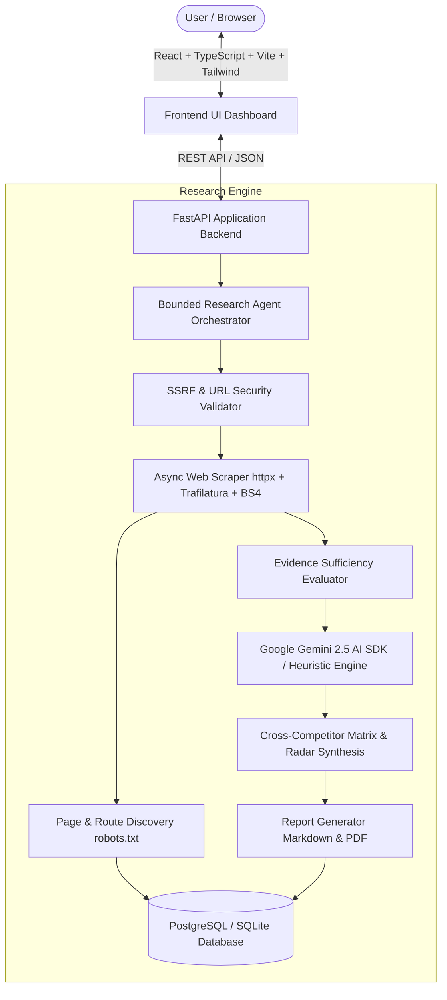
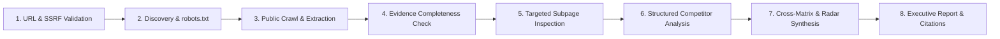

# CompetitorIQ — AI-Powered Competitor Research Platform

CompetitorIQ is an end-to-end, enterprise-grade competitive intelligence platform designed for founders, product leaders, and market analysts. It systematically collects public web signals, extracts structured capabilities, evaluates evidence completeness, and synthesizes executive research reports with verifiable citations.

---

## Architecture Overview



---

## 8-Step Bounded Agent Workflow

Unlike unconstrained autonomous agents that can hallucinate or loop unpredictably, CompetitorIQ implements an explicit, typed, 8-step pipeline:



1. **Request Validation**: Validates scheme (`http`/`https`), normalizes hosts, performs DNS resolution, and enforces SSRF blocks against loopback, private IP ranges (RFC 1918), and cloud metadata endpoints (`169.254.169.254`).
2. **Page Discovery**: Respects `robots.txt` directives, inspects sitemaps, and discovers relevant subpages (Pricing, Features, Products, About).
3. **Content Extraction**: Safely retrieves HTML with strict size limits (2MB max per page), extracts clean text via `trafilatura`, and captures headings, metadata, and tables with `BeautifulSoup`.
4. **Evidence Sufficiency Evaluation**: Checks whether public pricing, core features, and positioning disclosures are present.
5. **Targeted Discovery**: Automatically searches for pricing and product capabilities if missing from the homepage.
6. **AI Competitor Analysis**: Uses the Google Gemini API with typed Pydantic schemas (`CompetitorAnalysisSchema`) to extract verified facts, marketing CTAs, strengths, and limitations while isolating untrusted website instructions.
7. **Cross-Competitor Comparison**: Builds side-by-side capability matrices, pricing tier alignments, and radar data.
8. **Report Synthesis**: Generates an executive summary, strategic recommendations, traceable source links, and clear statements of research limitations.

---

## Technology Stack

### Backend
- **Framework**: FastAPI (Python 3.12 / 3.14)
- **Data Validation & Schemas**: Pydantic v2 & Pydantic Settings
- **ORM & Database**: SQLAlchemy 2.0 with connection pooling; supports PostgreSQL in production and SQLite for local development
- **Asynchronous Scraping**: HTTPX (async client with timeout and redirect verification)
- **Content Parsing**: Trafilatura (clean main-text extraction) & BeautifulSoup4 (DOM and metadata extraction)
- **AI Engine**: Google GenAI SDK (`google-genai 2.32.0`) with typed structured outputs and deterministic heuristic fallback
- **Testing**: Pytest, Pytest-Asyncio, FastAPI TestClient

### Frontend
- **Framework**: React 19 + TypeScript + Vite
- **Styling**: Tailwind CSS with custom slate-950 dark theme
- **Visualizations**: Recharts (multi-dimensional radar charts and feature density bar charts)
- **Icons**: Lucide React
- **Deployment**: Multi-stage Docker build with Nginx reverse proxy

---

## Security & Reliability Architecture

- **SSRF & DNS Rebinding Protection**: Resolves domain names prior to issuing HTTP requests. Rejects `localhost`, `127.0.0.1`, `10.0.0.0/8`, `172.16.0.0/12`, `192.168.0.0/16`, `169.254.169.254`, and non-standard ports (allowing only standard web ports 80/443).
- **Prompt Injection Defense**: Untrusted scraped website text is sanitized, defanged of instruction override markers, character-bounded, and fenced inside `<WEBSITE_EVIDENCE>` tags.
- **Strict Compliance**: Honors `robots.txt` crawl rules and never attempts to bypass paywalls, CAPTCHAs, or authentication barriers.
- **Zero Hallucination Policy**: If pricing or customer statistics are not explicitly documented on public pages, they are tagged as `"Not publicly verified"` rather than guessed.

---

## API Endpoints

| Method | Endpoint | Description |
|---|---|---|
| `POST` | `/api/projects` | Create a research workspace with 1–5 competitors |
| `GET` | `/api/projects` | List all research projects with metrics |
| `GET` | `/api/projects/{id}` | Get project details, competitors, and latest job |
| `DELETE` | `/api/projects/{id}` | Delete project with cascading cleanup |
| `POST` | `/api/projects/{id}/competitors` | Add a competitor to an existing workspace |
| `GET` | `/api/projects/{id}/competitors` | List competitors for a workspace |
| `POST` | `/api/projects/{id}/research` | Launch asynchronous research job |
| `GET` | `/api/research/{job_id}` | Poll job status, progress percentage, and live logs |
| `GET` | `/api/research/{job_id}/report` | Retrieve completed executive report |
| `GET` | `/api/research/{job_id}/sources` | Retrieve all evidence citations and excerpts |
| `GET` | `/api/research/{job_id}/export/markdown` | Download formatted report as `.md` file |
| `POST` | `/api/demo/seed` | Instantly load the demo dataset (DevPulse AI vs Cursor & Copilot) |
| `GET` | `/api/health` | System health and Gemini API availability status |

---

## Local Setup & Quickstart

### Prerequisites
- Python 3.10+
- Node.js 18+ & npm
- (Optional) Docker & Docker Compose

### 1. Clone & Environment Setup
```bash
git clone https://github.com/your-username/competitoriq.git
cd competitoriq
cp .env.example .env
```

### 2. Backend Setup
```bash
cd backend
python -m venv venv
# On Windows:
.\venv\Scripts\activate
# On Linux/macOS:
source venv/bin/activate

pip install -r requirements.txt
uvicorn app.main:app --reload --port 8000
```
Backend API documentation is live at `http://localhost:8000/docs`.

### 3. Frontend Setup
```bash
cd ../frontend
npm install --legacy-peer-deps
npm run dev
```
Open `http://localhost:5173` in your browser.

---

## Docker Compose Setup

Run the full stack (PostgreSQL, FastAPI Backend, and Nginx Frontend) with a single command:

```bash
docker-compose up --build
```

- Frontend: `http://localhost`
- Backend API: `http://localhost:8000`
- API Docs: `http://localhost:8000/docs`
- PostgreSQL: `localhost:5432`

---

## Adding a Google Gemini API Key

CompetitorIQ runs seamlessly in two modes:
1. **Fallback Heuristic Mode (Out of the Box)**: Uses deterministic text and DOM heuristics to extract features, pricing tables, and value propositions directly from public pages without requiring an API key.
2. **Gemini 2.5 Active Mode**: Provides deep contextual synthesis, nuanced positioning analysis, and market gap identification.

To activate Gemini:
1. Generate an API key at [Google AI Studio](https://aistudio.google.com/).
2. Set the key in your `.env` or environment:
   ```env
   GEMINI_API_KEY="your-gemini-api-key-here"
   GEMINI_MODEL="gemini-2.5-flash"
   ```
3. Restart the backend. The top navigation bar will automatically display **"Gemini 2.5 Active"**.

---

## Running Automated Tests

Run the test suite with pytest:

```bash
cd backend
pytest -v
```

All 18 automated tests verify:
- Strict SSRF protection and loopback rejection
- URL scheme safety and port restrictions
- HTML extraction and metadata parsing
- Link discovery and subpage classification
- Pydantic schema validation for structured outputs
- Report markdown synthesis
- Project CRUD lifecycle, competitor boundaries, and duplicate rejection
- Demo dataset seeding and report retrieval

---

## Project Structure

```
competitoriq/
├── backend/
│   ├── app/
│   │   ├── api/             # REST endpoints (projects, research, health, demo)
│   │   ├── core/            # Configuration and SSRF/URL security utilities
│   │   ├── db/              # SQLAlchemy session and initialization
│   │   ├── models/          # SQLAlchemy data models
│   │   ├── schemas/         # Pydantic v2 request/response and AI schemas
│   │   ├── research/        # Safe web scraper and 8-step agent workflow
│   │   ├── ai/              # Google Gemini client and structured fallback engine
│   │   ├── reports/         # Markdown report generator
│   │   └── main.py          # FastAPI application entrypoint
│   ├── tests/               # Pytest automated test suite
│   ├── Dockerfile
│   ├── pytest.ini
│   └── requirements.txt
├── frontend/
│   ├── src/
│   │   ├── components/      # Navbar and reusable UI controls
│   │   ├── pages/           # Dashboard, NewResearch, ResearchProgress, Analysis, Report
│   │   ├── services/        # Frontend API client
│   │   ├── types/           # TypeScript interfaces
│   │   ├── App.tsx          # Main application router and state
│   │   └── index.css        # Tailwind and dark aesthetic tokens
│   ├── Dockerfile
│   ├── nginx.conf
│   └── package.json
├── docker-compose.yml
├── .env.example
├── .gitignore
└── README.md
```

---

## Limitations & Future Enhancements

### Current Capabilities & Boundaries
- Extracts only publicly exposed website text and metadata; internal corporate intranets, authenticated dashboards, and paywalled pages are never accessed.
- Unverified items (e.g., undisclosed customer volume, private contract discounts) are labeled as `"Not publicly verified"` rather than fabricated.

### Roadmap
- Webhook notifications upon research job completion
- Automated scheduled re-crawling with visual diff alerts on pricing changes
- PDF direct vector report generation using WeasyPrint
- Multi-language competitor page translation
